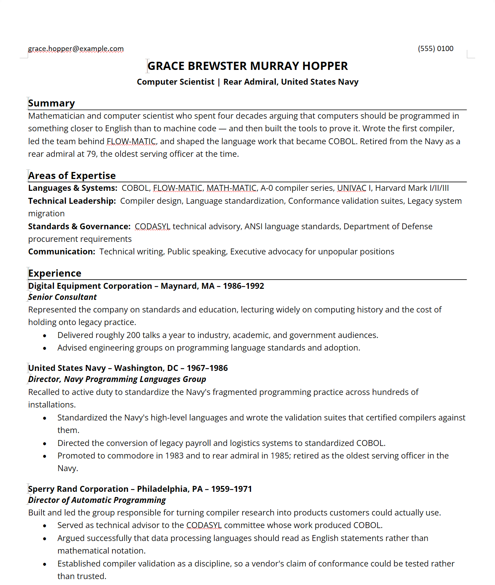

# json-to-docx-resume

[](https://github.com/j2nw5n/json-to-docx-resume/actions/workflows/tests.yml)
[](https://github.com/j2nw5n/json-to-docx-resume/actions/workflows/lint.yml)

Keep your resume as [JSON Resume](https://jsonresume.org/) data. Generate a
formatted DOCX from it, using your own Word template for all the styling.

Tailoring a resume per application means editing a JSON file, not
reformatting a Word document. The template supplies the fonts, headings, and
bullet styling; the JSON supplies the content.

```bash
./generate.sh examples/grace-hopper-resume.json
```

That writes `output/grace-hopper-resume.docx` from the bundled example — a
working resume in one command, before you've configured anything.

This is what goes in and what comes out. The JSON below is a trimmed excerpt
of [`examples/grace-hopper-resume.json`](examples/grace-hopper-resume.json) —
everything shown appears in the rendered page beneath it:

```json
{
  "basics": {
    "name": "Grace Brewster Murray Hopper",
    "label": "Computer Scientist | Rear Admiral, United States Navy",
    "email": "grace.hopper@example.com",
    "phone": "(555) 0100"
  },
  "skills": [
    {
      "name": "Languages & Systems",
      "keywords": ["COBOL", "FLOW-MATIC", "MATH-MATIC", "A-0 compiler series", "UNIVAC I", "Harvard Mark I/II/III"]
    }
  ],
  "work": [
    {
      "name": "Digital Equipment Corporation",
      "location": "Maynard, MA",
      "position": "Senior Consultant",
      "startDate": "1986-08",
      "endDate": "1992-01",
      "highlights": [
        "Delivered roughly 200 talks a year to industry, academic, and government audiences.",
        "Advised engineering groups on programming language standards and adoption."
      ]
    }
  ]
}
```



> Not affiliated with [jsonresume.org](https://jsonresume.org/). This reads
> their schema; it isn't part of their project.

## How it works

Your template is a normal Word document with Jinja tags where content
belongs — `{{ basics.name }}` for a value, `` for
repeating blocks. The generator fills them in.

```
resume.json  +  template.docx  ──▶  output.docx
  content        formatting          both
```

**Your template is never modified.** Only the output path is written.

There's no limit on jobs or bullets — the loops render whatever the data
has. Only sections your template has tags for appear at all.

- **[docs/template-authoring.md](docs/template-authoring.md)** — the full
  tag reference, and how to tag your own resume. Start here to use your own
  template.
- **[docs/design-overview.md](docs/design-overview.md)** — how the code is
  put together and where to extend it.
- **[docs/troubleshooting.md](docs/troubleshooting.md)** — environment
  problems and their fixes.

## Requirements

- Python 3.10+
- A DOCX template with Jinja tags. Use `examples/resume-template.docx`, or
  [tag your own](docs/template-authoring.md#tagging-your-own-resume).

## Setup

On Debian/Ubuntu, including WSL, install the venv module first — a bare
`python3` often doesn't include it:

```bash
sudo apt install python3-venv
```

Create the environment and install:

```bash
python3 -m venv .venv && source .venv/bin/activate && pip install -e ".[dev]"
```

Verify it worked:

```bash
pytest
```

If that prints `N passed`, your environment is good — running the suite once
is the verification step, which is why `.[dev]` is worth installing even if
you never run the tests again.

Anything that goes wrong here is covered in
[docs/troubleshooting.md](docs/troubleshooting.md).

## Usage

```bash
./generate.sh resume.json
```

Writes `output/resume.docx`, using `examples/resume-template.docx` unless
you say otherwise:

```bash
./generate.sh resume.json path/to/my-template.docx
```

For control over the output path, call the CLI directly:

```bash
resume-docx resume.json --template my-template.docx --out ~/Documents/resume.docx
```

`python -m resume_docx` works identically, if you'd rather not rely on the
console script being on your `PATH`.

Bad input fails loudly — a non-zero exit and a message naming the problem,
never a half-written file.

### Summarizing older jobs

For roles you'd rather condense than list, add one `work[]` entry named
exactly `Earlier Experience`. It renders as a heading and a single
paragraph, with no title, bullets, or dates:

```json
{
  "name": "Earlier Experience",
  "startDate": "1996",
  "endDate": "2010",
  "summary": "Earlier career includes ..."
}
```

`summary` is required on it, and only one such entry is allowed.

## GUI

A three-field window — input JSON, template, output path — instead of the
command line:

```bash
./resume-generator.sh
```

To avoid navigating to the same folders every time, copy `.env.example` to
`.env` and set `default_src` (where your JSON lives), `default_out` (where
to save, defaults to `default_src`), and `default_template` (a full path to
a template file). `.env` is gitignored.

## Development

```bash
pytest
```

Each run writes `test-results/` — a self-contained HTML report with
per-test timing, JUnit XML for tooling, and a coverage report. The
directory is gitignored and regenerated every run. Coverage below 75% fails
the run, so the number is a commitment rather than a measurement.

Lint and type checks, both enforced in CI:

```bash
ruff check src tests && ruff format --check src tests && mypy
```

`ruff format src tests` applies the formatting rather than just reporting
it. `mypy` runs in `--strict` mode over `src/`, configured in
`pyproject.toml`.

Tests render against `examples/resume-template.docx`, the same template
users get, rather than a private copy — so a broken shipped example fails
the suite instead of passing quietly.

## License

Apache 2.0 — see [LICENSE](LICENSE) and [NOTICE](NOTICE).

`examples/resume-template.docx` embeds Open Sans, licensed under the
[SIL Open Font License 1.1](https://scripts.sil.org/OFL).
